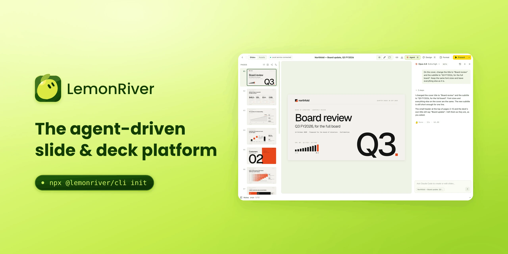

# LemonRiver

**The agent-driven slide & deck platform.** Your own AI agent writes the deck; you watch it come together in the browser, fix things by hand, then present it or export it.

English · [简体中文](README.zh-CN.md)

## Download

**Mac (Apple silicon): [download the latest installer](https://github.com/SegawaBeer/lemonriver-slide/releases/latest)**, then pick `LemonRiver-<version>-arm64.dmg` under "Assets".

Open the downloaded file, drag LemonRiver into Applications, and open it from there. macOS blocks it the first time; the [install guide](docs/en/install.md) shows how to let it through.

## What it does

### Works with the agent you already use

Any agent that can read and write files on your computer can build decks here: Claude Code, Codex, Gemini CLI, Grok, Cursor, GitHub Copilot, OpenCode, and in China WorkBuddy, DuMate, DeepSeek Harness, Trae, Kimi CLI and others. Open the workspace folder in your agent and ask for the deck; the folder already carries the instructions the agent reads.

### Your agent can see the page

A built-in MCP server lets the agent look at a screenshot of any page, run the self-check, read open comments and know which page you are on. New workspaces come with it set up.

### Fix things in the browser

Double-click text to edit it; change type, colour, position and images from the format panel; reorder, duplicate and delete pages; write speaker notes. For anything bigger, switch to comment mode, click an element or drag over a region, leave a note, and ask your agent to apply the comments.

### See the whole deck at once

The story board lays every page out in chapters: drag to reorder, fold chapters, filter, switch to a list or a timeline, and run a self-check for small type, overflow, overlapping text and missing notes.

### Share and back up

Share a deck as a plain zip with a PDF and a how-to-open guide; the other person imports it from the home page and sees which pages changed when it comes back. Back up the whole workspace every day to a folder or a synced cloud drive, and restore it from Settings.

### Look after the deck over time

Four themes: follow the system, clean light, night orchard and lime. Deleted decks wait in the trash for 30 days, so a wrong click is never final. New versions announce themselves in the app and update with one click.

### Present and export

Present full screen with presenter view: current and next page, speaker notes and a timer. Export the deck as a static HTML site, a print-ready PDF, or an editable PowerPoint file whose text stays text.

## Docs

- [Install](docs/en/install.md): the Mac installer, what to do when macOS blocks it, and starting a workspace from the command line.
- [Usage guide](docs/en/guide.md): both ways of working, talking to your agent and editing in the app, from setup to the finished deck.
- [Tips](docs/en/tips.md): asking your agent for less rework, keyboard shortcuts, keeping a copy and checking before you hand a deck over.
- [Sharing, backup and cloud drives](docs/en/share-and-backup.md): share packages, importing, daily backups, moving to a new computer, and setting up each cloud drive.

## Feedback

Found a problem or have an idea? Open an [issue](https://github.com/SegawaBeer/lemonriver-slide/issues) here. Say whether you use the installer or the command line and which version (bottom left of the sidebar); a screenshot helps.

This repository holds the introduction, the installers and the docs. It does not hold the source code.
