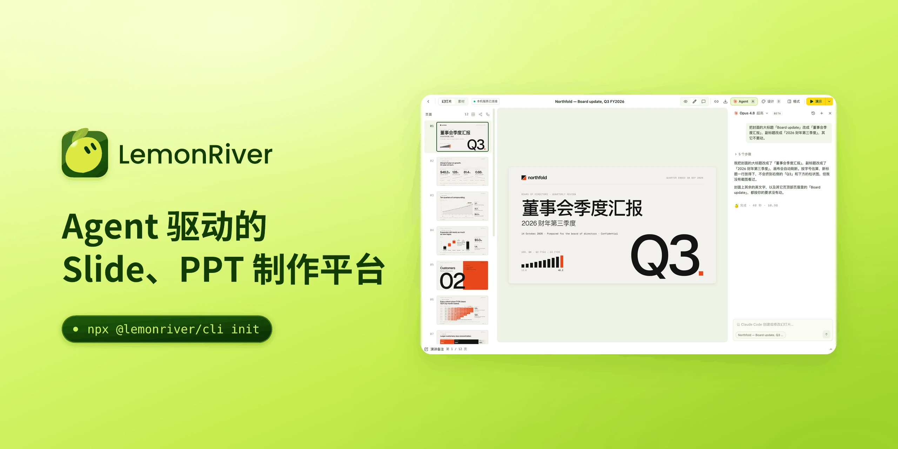

# LemonRiver

**Agent 驱动的 Slide、PPT 制作平台。** 幻灯片由你自己的 AI Agent 来写，你在浏览器里看着它成形、动手改，最后直接演示或者导出。

[English](README.md) · 简体中文

## 下载

**Mac（Apple 芯片）：[下载最新版安装包](https://github.com/SegawaBeer/lemonriver-slide/releases/latest)**，在页面下方「Assets」里点 `LemonRiver-<版本>-arm64.dmg`。

打开下载的文件，把 LemonRiver 拖进「应用程序」，再从「应用程序」里打开。第一次打开会被系统拦下，处理办法见[安装说明](docs/zh-CN/install.md)。

## 能做什么

### 用你已经在用的 Agent

能读写你电脑上文件的 Agent 都能用：国内常用的 WorkBuddy、DuMate、DeepSeek Harness、Trae、千问办公、豆包、Kimi CLI，海外常用的 Claude Code、Codex、Gemini CLI、Grok、Cursor、GitHub Copilot、OpenCode 等。在 Agent 里打开工作区文件夹，跟它说要什么样的幻灯片就行，给 Agent 看的说明已经放在文件夹里了。

### Agent 看得见页面

自带 MCP 服务：Agent 能截任意一页来看、跑自检、读还没处理的评论、知道你正在看哪一页。新建的工作区已经配好。

### 在浏览器里直接改

双击文字直接改；在格式面板里改字号、颜色、位置和图片；调页序、复制、删除页；写演讲备注。界面改不了的，切到评论模式，点一个元素或拖一个框留句话，再让 Agent「应用评论」。

### 整份幻灯片一眼看完

故事看板按章节摆出每一页：拖动调顺序、折叠章节、筛选，切成列表或时间轴；一键自检字太小、内容出界、文字压线和缺讲稿。

### 分享和备份

把一份演示打成普通压缩包分享，附 PDF 和「怎么打开」说明；对方在首页导入，改完发回来时能看出改了哪几页。整个工作区每天备份到本机文件夹或云盘的同步文件夹，在设置里一键恢复。

### 用久了也不乱

四套主题：跟随系统、清爽白、夜间果园、青柠沉浸。删掉的幻灯片在回收站里留 30 天，点错了也能捞回来。有新版本时应用里会提示，点一下就能更新。

### 演示和导出

全屏演示，带演讲者视图：当前页和下一页、备注、计时器。导出可以是静态 HTML 网站、适合打印的 PDF，也可以是文字还能继续编辑的 PowerPoint。

## 文档

- [安装说明](docs/zh-CN/install.md)：Mac 安装包、第一次打开被拦住怎么办、用命令行建工作区。
- [使用指南](docs/zh-CN/guide.md)：两种用法（跟 Agent 说、在界面里改）从准备到收尾。
- [技巧](docs/zh-CN/tips.md)：怎么跟 Agent 说更省事、常用快捷键、留底和交付前检查。
- [分享、备份和云盘](docs/zh-CN/share-and-backup.md)：分享包、导入、每天备份、换电脑恢复、各家云盘怎么设。

## 反馈

遇到问题或者有想法，在这个仓库的 [Issues](https://github.com/SegawaBeer/lemonriver-slide/issues) 里写下来。说明一下你用的是安装包还是命令行、哪个版本（侧栏左下角能看到），有截图更好。

这个仓库只放介绍、安装包和文档，不放源码。
