# open-slide demo decks

These 18 decks are the demo slides that ship with [open-slide](https://github.com/1weiho/open-slide), the project LemonRiver is built on. They are MIT licensed; copyright Yiwei Ho. The licence text is in [LICENSE](LICENSE).

## Opening a deck in LemonRiver

Copy a deck folder, for example `aero-3-launch`, into the `slides/` folder of your LemonRiver workspace. The deck shows up on the app's home view the next time you open it.

## The decks

| Cover | Deck | What it is | Pages |
| --- | --- | --- | --- |
| 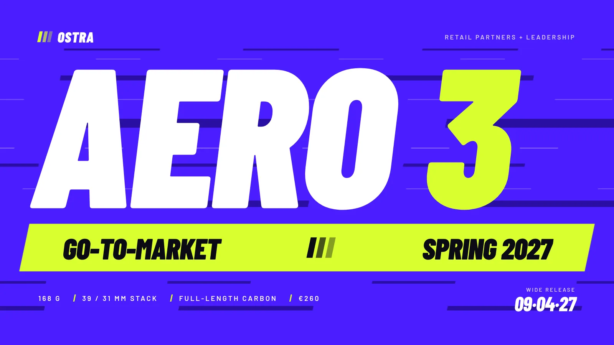 | **Ostra AERO 3 — Go-to-market, Spring 2027** | Ostra's go-to-market deck for the AERO 3, a 168 g sneaker launching in spring 2027. | 13 |
| 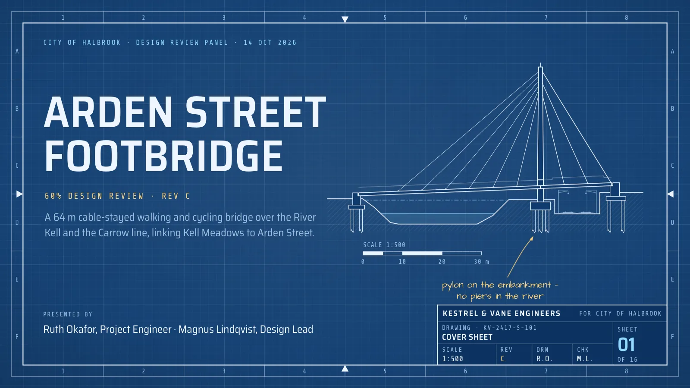 | **Arden Street Footbridge — 60% Design Review** | The 60% design review of the Arden Street Footbridge, a 64 m cable-stayed crossing, presented to the City of Halbrook design review panel. | 16 |
| 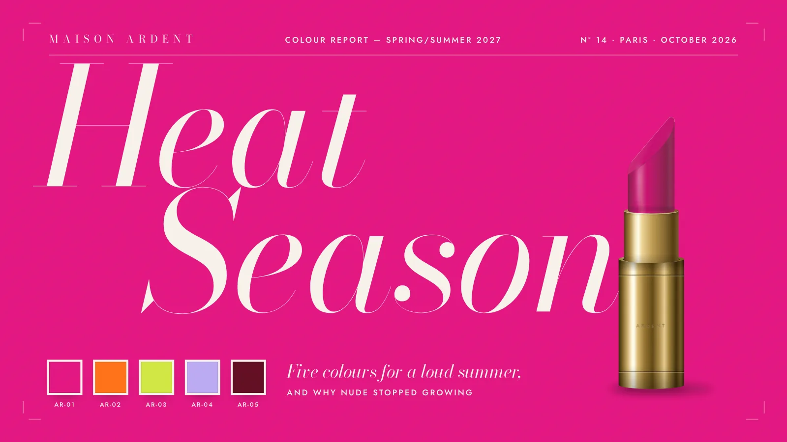 | **Maison Ardent — Colour Report SS27** | Maison Ardent's spring/summer 2027 colour report, built around the season's Heat palette. | 12 |
| 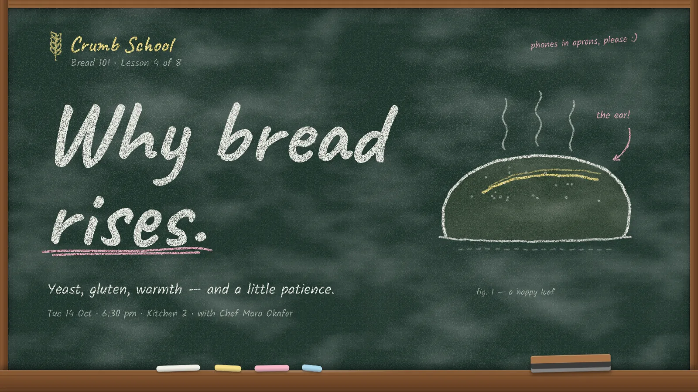 | **Crumb School — Why Bread Rises** | Bread 101, lesson 4 of 8 at Crumb School: why bread rises. | 15 |
| 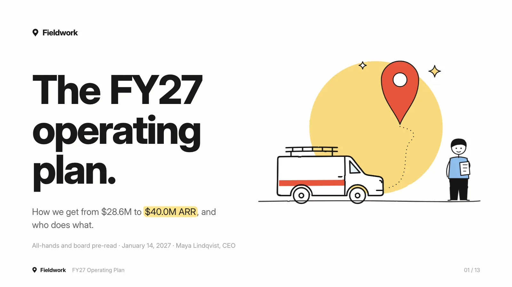 | **Fieldwork — FY27 Operating Plan** | Fieldwork's FY27 operating plan, an all-hands and board pre-read at $40.0M ARR. | 13 |
| 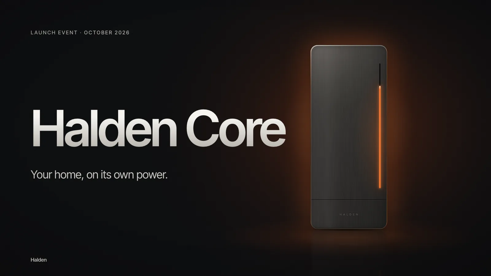 | **Halden Core — Launch keynote** | Launch keynote for Halden Core, a home battery that runs a house on its own power. | 12 |
| 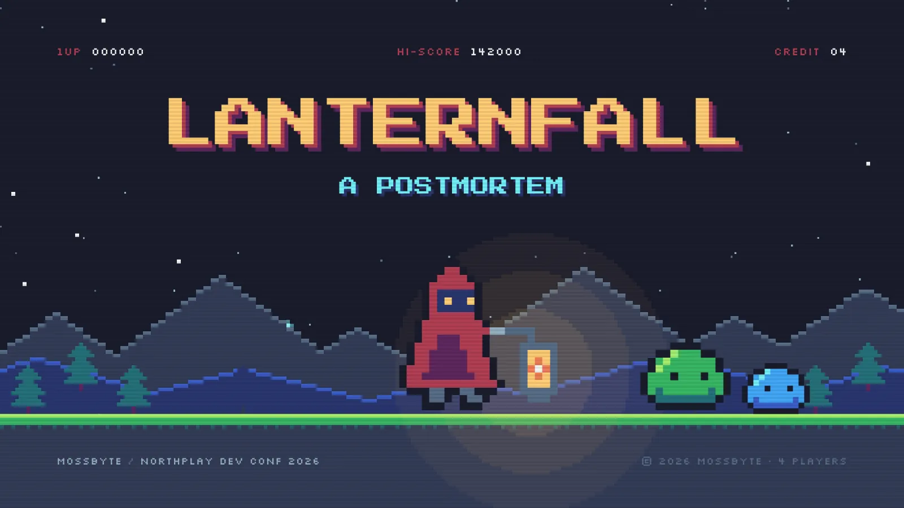 | **Lanternfall: A Postmortem** | A postmortem for Lanternfall, told through an arcade hi-score screen. | 15 |
| 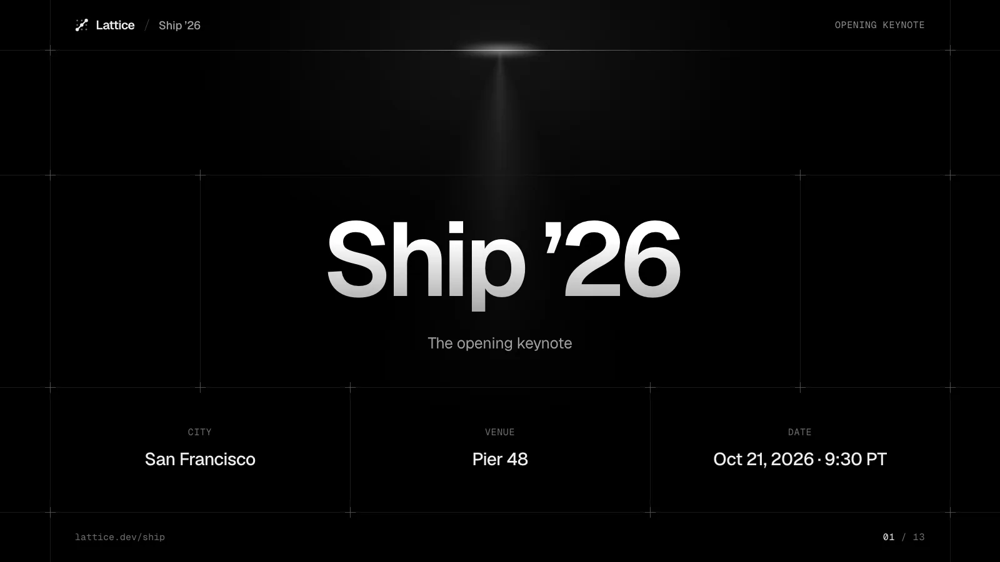 | **Lattice — Ship '26 keynote** | Lattice's Ship '26 opening keynote, San Francisco, Pier 48. | 13 |
| 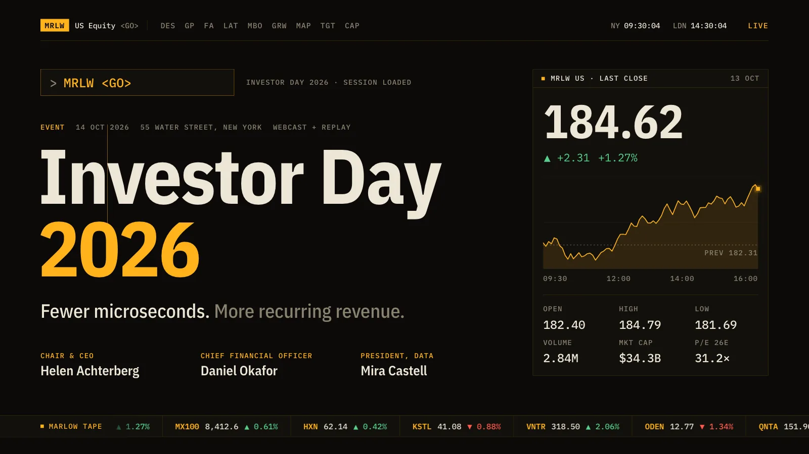 | **Marlow Exchange — Investor Day 2026** | Marlow Exchange's investor day 2026, opening on a markets terminal. | 12 |
| 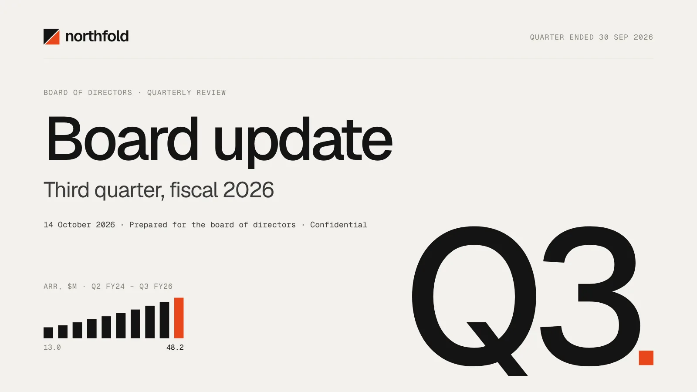 | **Northfold — Board update, Q3 FY2026** | Northfold's confidential board update for the quarter ended 30 September 2026. | 12 |
| 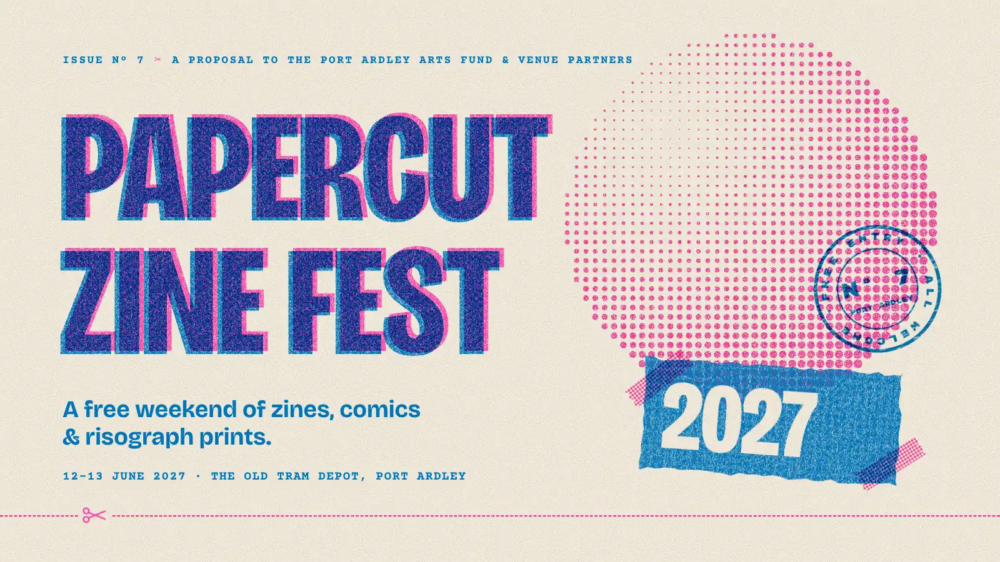 | **Papercut Zine Fest 2027** | A proposal to the Port Ardley Arts Fund and venue partners for Papercut Zine Fest, 12–13 June 2027. | 16 |
| 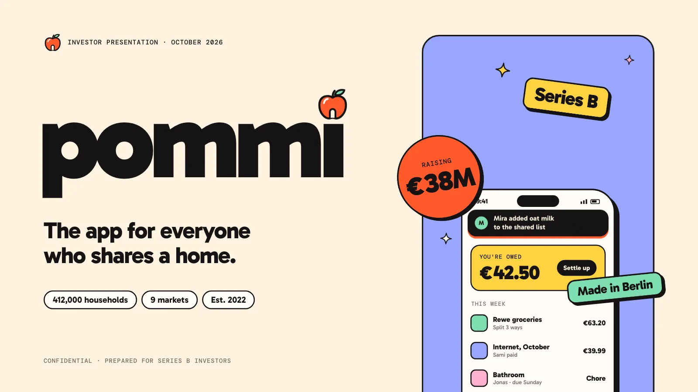 | **Pommi — Series B** | Pommi's Series B deck for the app for everyone who shares a home. | 12 |
| 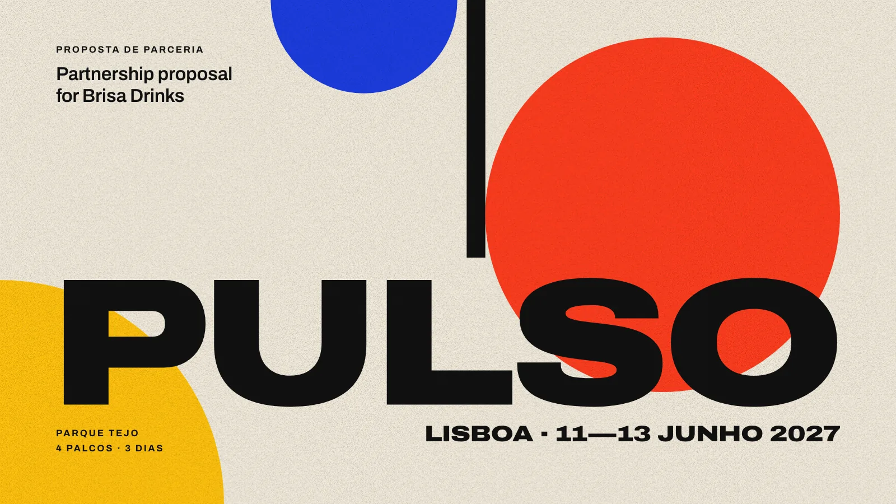 | **Pulso Lisboa 2027 — Partnership proposal** | A partnership proposal for Pulso Lisboa 2027, written in Portuguese. | 13 |
| 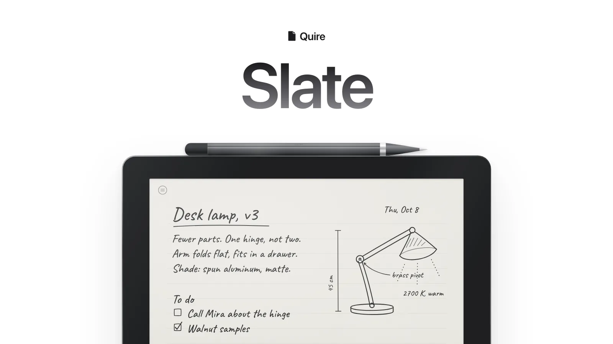 | **Quire Slate — Keynote** | The Quire Slate keynote, opening on a sketchbook page for the v3 desk lamp. | 12 |
| 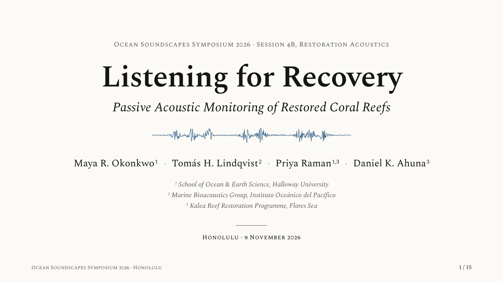 | **Listening for Recovery** | A talk at the Ocean Soundscapes Symposium 2026 on passive acoustic monitoring of restored coral reefs. | 15 |
| 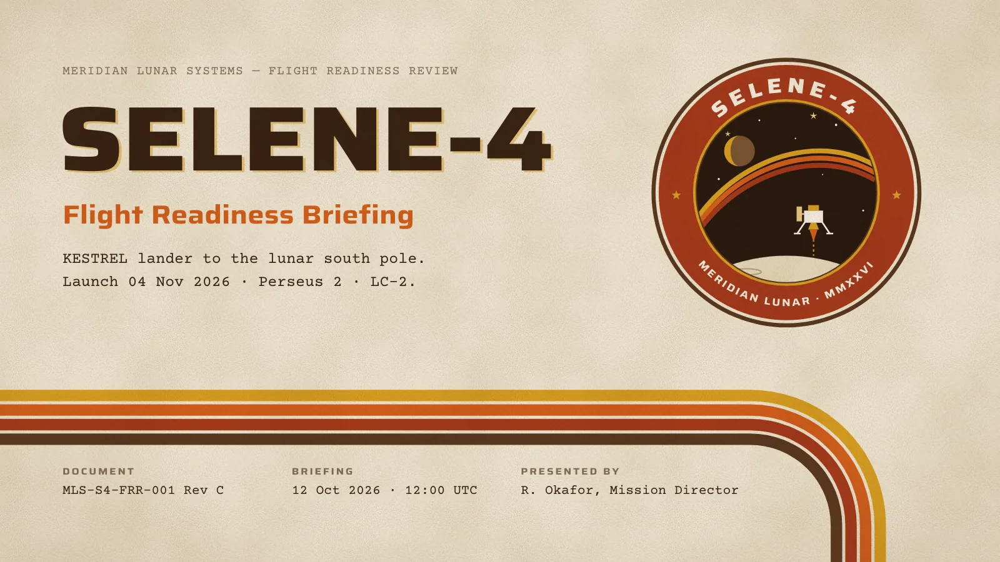 | **SELENE-4 Flight Readiness Briefing** | Meridian Lunar Systems' SELENE-4 flight readiness briefing, October 2026. | 14 |
| 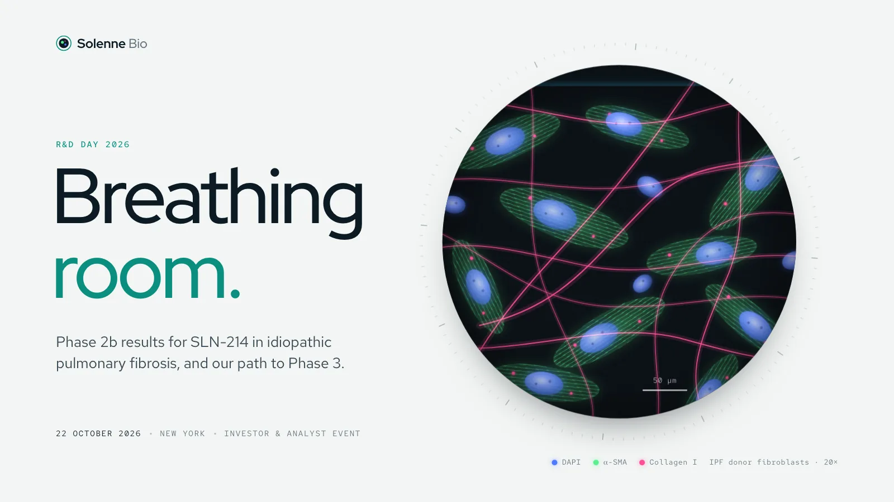 | **Solenne Bio — R&D Day 2026** | Solenne Bio's R&D day 2026: Phase 2b results for SLN-214 in idiopathic pulmonary fibrosis. | 13 |
| 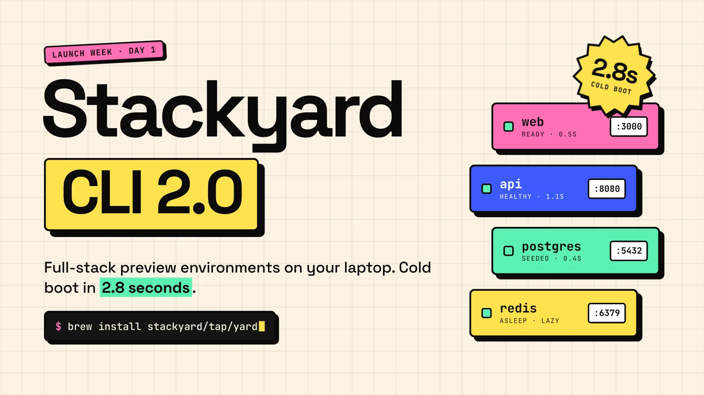 | **Stackyard CLI 2.0 — Launch** | Launch-week deck for Stackyard CLI 2.0. | 15 |
