# open-slide 官方演示作品

这 18 份是 [open-slide](https://github.com/1weiho/open-slide) 自带的演示作品，LemonRiver 就建立在它之上。采用 MIT 许可，版权归 Yiwei Ho。许可全文见 [LICENSE](LICENSE)。

## 怎么在 LemonRiver 里打开

把某一份的文件夹（比如 `aero-3-launch`）复制进你自己工作区的 `slides/` 文件夹，下次打开 LemonRiver 时它就会出现在首页。

## 作品列表

| 封面 | 作品 | 一句话说明 | 页数 |
| --- | --- | --- | --- |
| 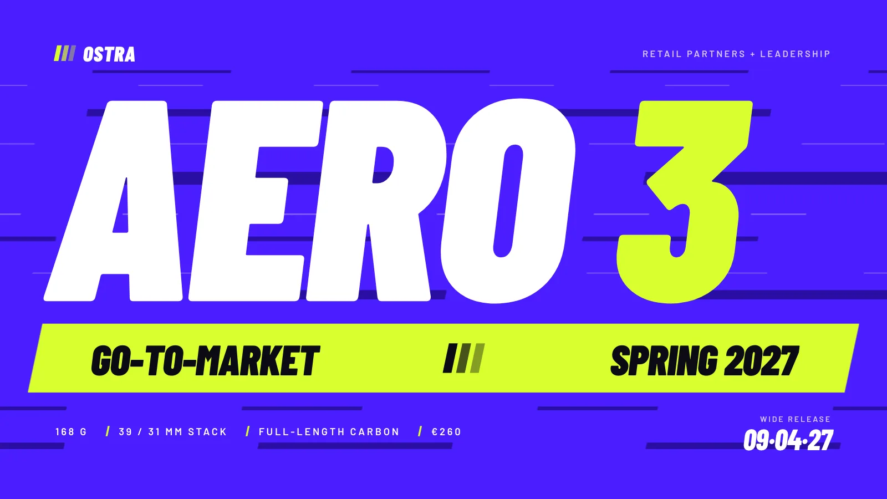 | **Ostra AERO 3 — Go-to-market, Spring 2027** | Ostra 为 AERO 3 运动鞋做的春季 2027 上市方案，168 克的鞋款，面向零售伙伴和公司管理层。 | 13 |
| 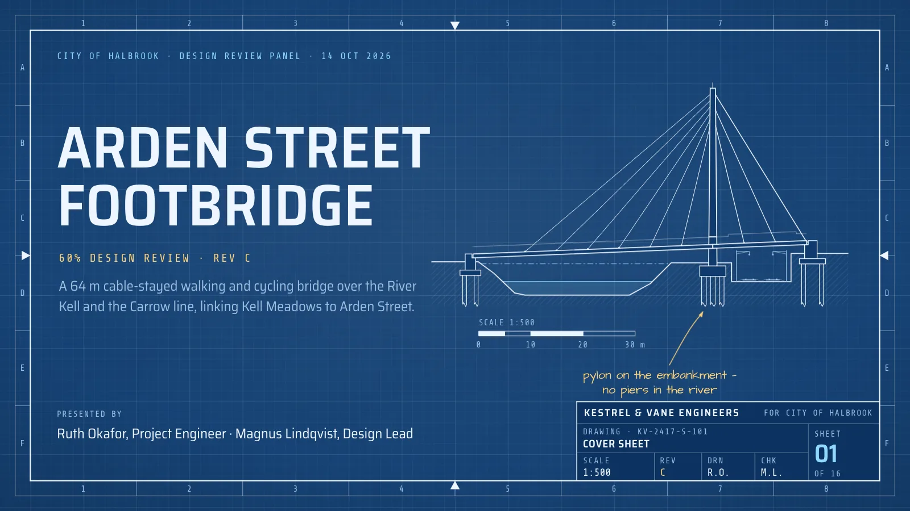 | **Arden Street Footbridge — 60% Design Review** | Arden Street 人行天桥的 60% 设计评审稿，64 米斜拉桥，向 Halbrook 市设计评审委员会汇报。 | 16 |
| 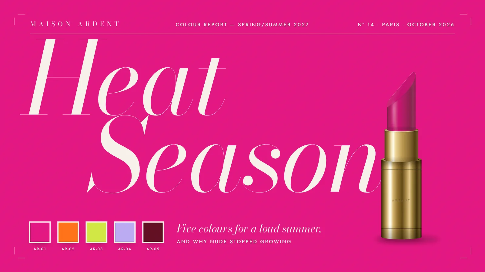 | **Maison Ardent — Colour Report SS27** | Maison Ardent 的 2027 春夏色彩报告，围绕本季的 Heat 色板。 | 12 |
| 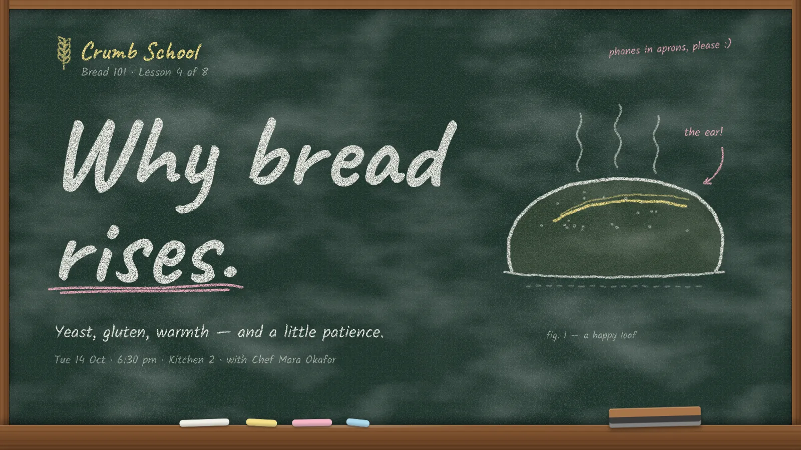 | **Crumb School — Why Bread Rises** | Crumb School 面包课第 4 讲（共 8 讲）：面包为什么会发起来。 | 15 |
| 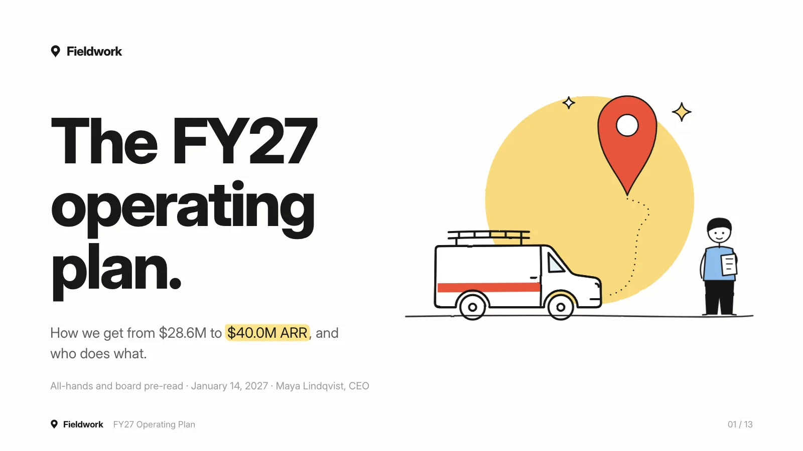 | **Fieldwork — FY27 Operating Plan** | Fieldwork 的 FY27 经营计划，全员与董事会预读材料，ARR 4000 万美元。 | 13 |
| 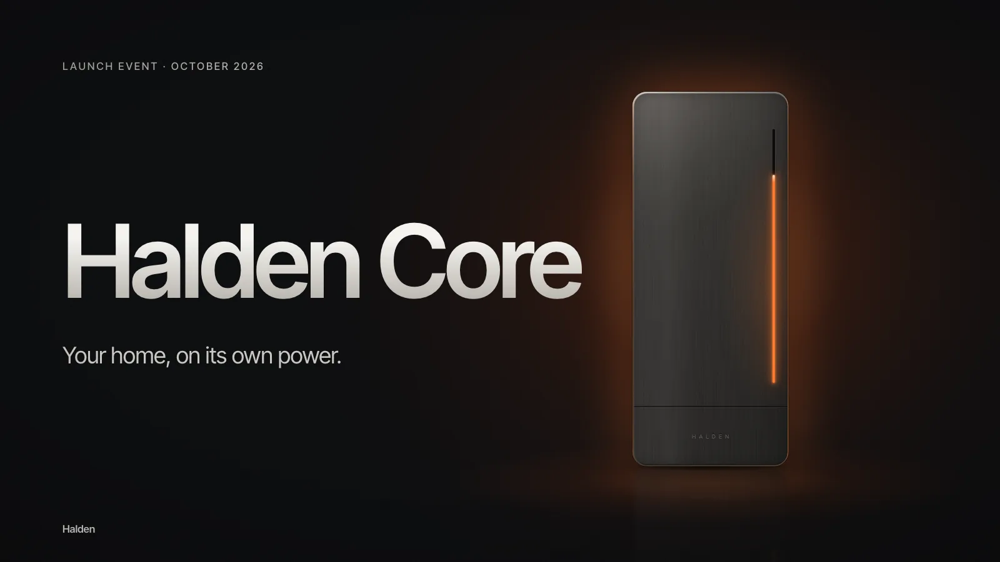 | **Halden Core — Launch keynote** | Halden Core 发布会主题演讲，一块让房子自己供电的家用电池。 | 12 |
| 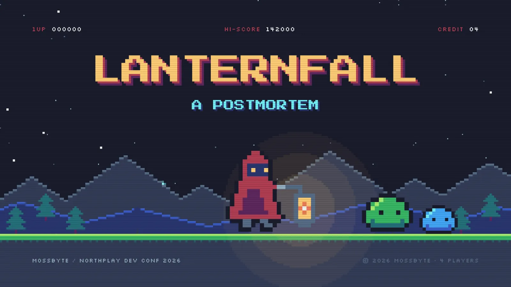 | **Lanternfall: A Postmortem** | Lanternfall 的项目复盘，用街机高分屏的方式讲述。 | 15 |
| 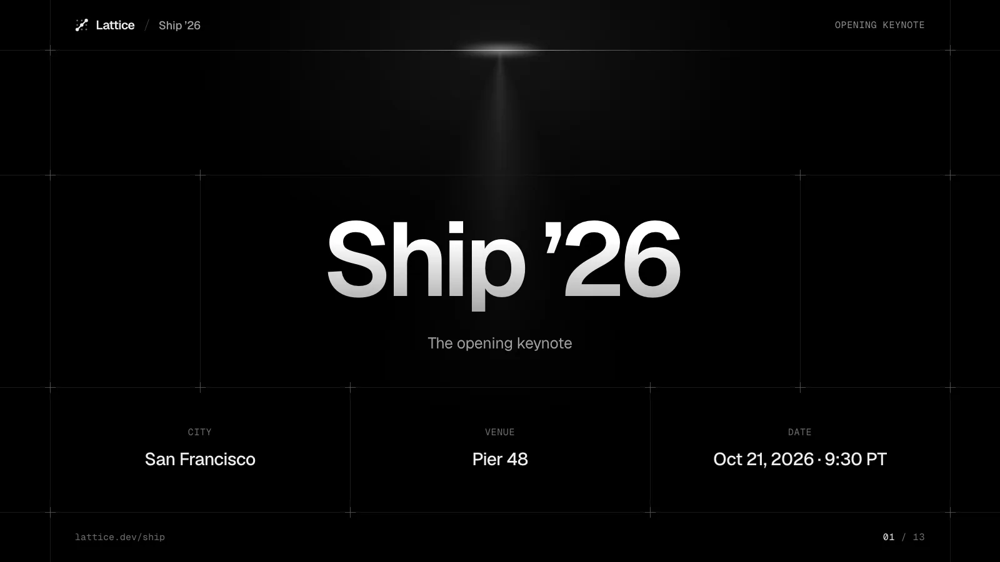 | **Lattice — Ship '26 keynote** | Lattice 的 Ship '26 大会开场主题演讲，旧金山 Pier 48。 | 13 |
| 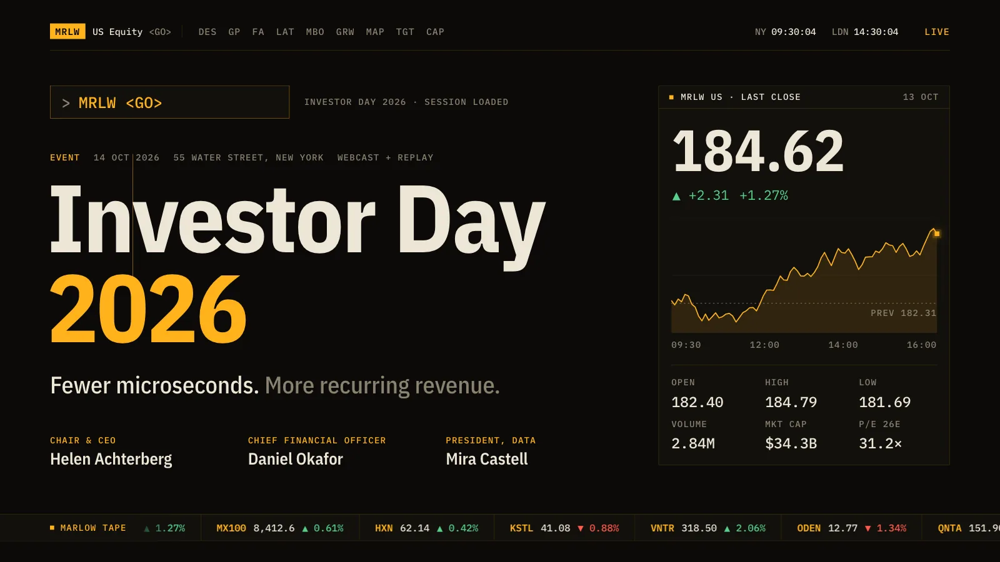 | **Marlow Exchange — Investor Day 2026** | Marlow Exchange 的 2026 投资者日，开篇是一页行情终端。 | 12 |
| 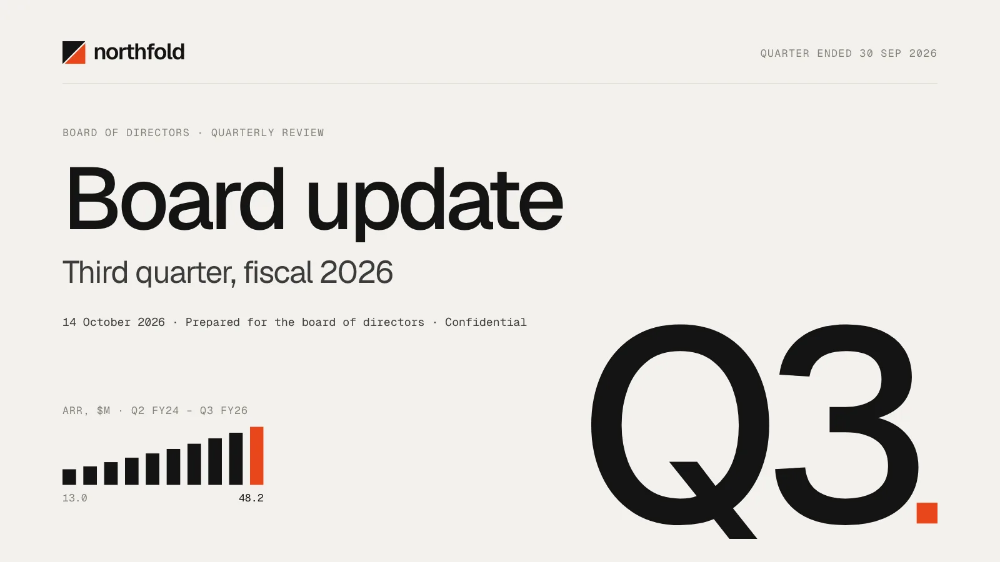 | **Northfold — Board update, Q3 FY2026** | Northfold 截至 2026 年 9 月 30 日的季度董事会汇报，机密。 | 12 |
| 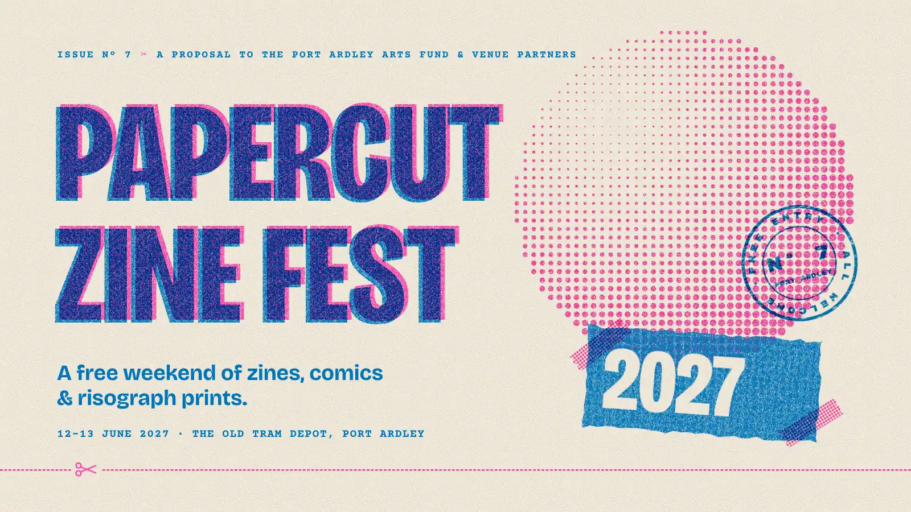 | **Papercut Zine Fest 2027** | 向 Port Ardley 艺术基金和场馆伙伴提交的 Papercut Zine Fest 方案，2027 年 6 月 12–13 日。 | 16 |
| 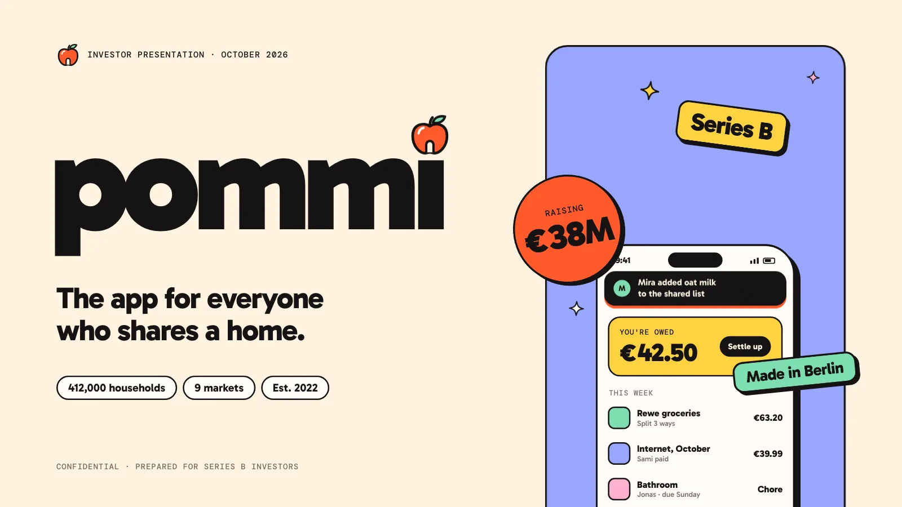 | **Pommi — Series B** | Pommi 的 B 轮融资稿，产品是给合住的人用的记账应用。 | 12 |
| 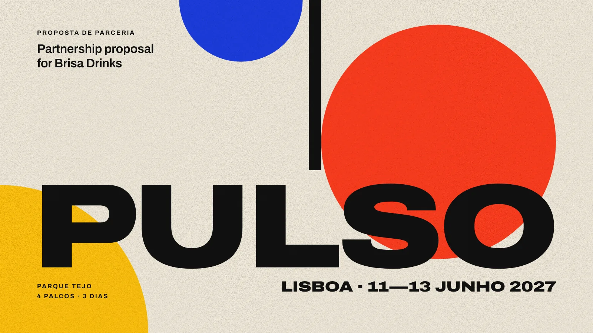 | **Pulso Lisboa 2027 — Partnership proposal** | Pulso Lisboa 2027 的合作方案，正文是葡萄牙语。 | 13 |
| 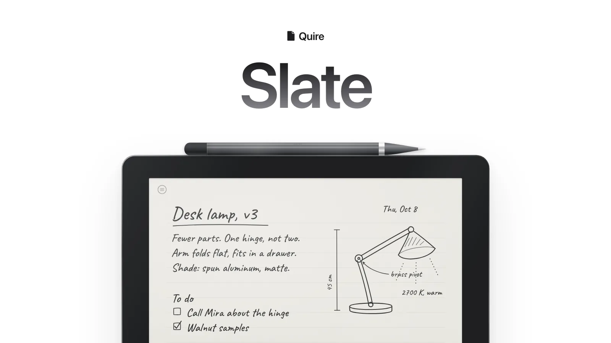 | **Quire Slate — Keynote** | Quire Slate 主题演讲，开篇是 v3 台灯的速写本页。 | 12 |
| 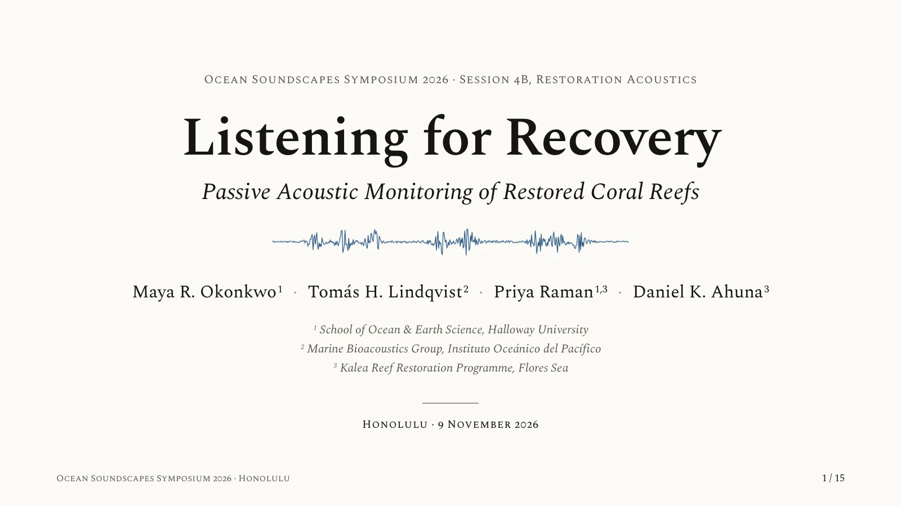 | **Listening for Recovery** | Ocean Soundscapes 2026 研讨会报告：用被动声学监测修复中的珊瑚礁。 | 15 |
| 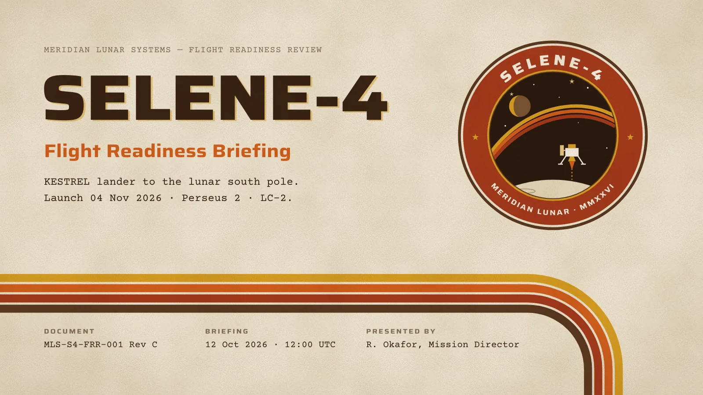 | **SELENE-4 Flight Readiness Briefing** | Meridian Lunar Systems 的 SELENE-4 飞行准备评审简报，2026 年 10 月。 | 14 |
| 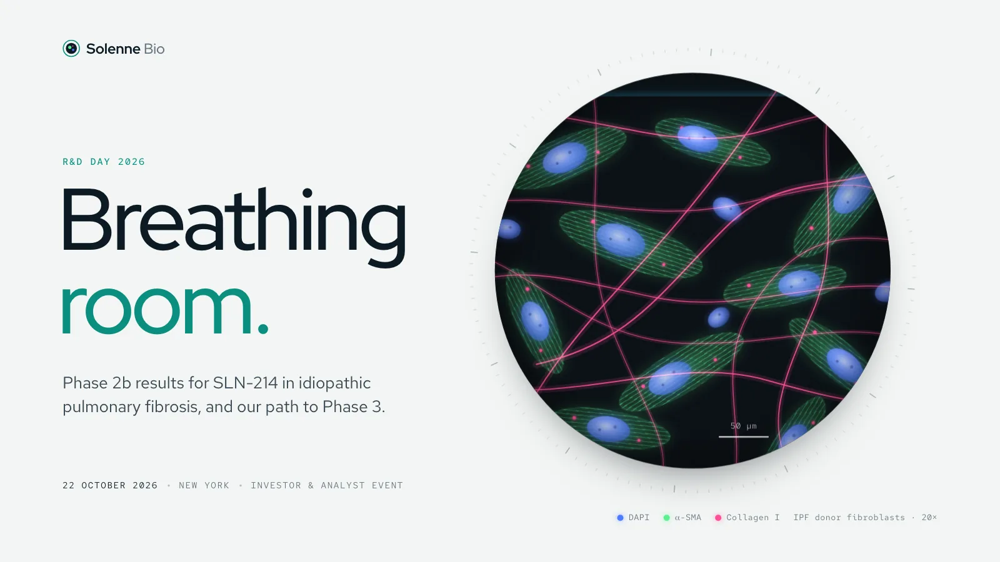 | **Solenne Bio — R&D Day 2026** | Solenne Bio 2026 研发日：SLN-214 治疗特发性肺纤维化的 2b 期结果。 | 13 |
| 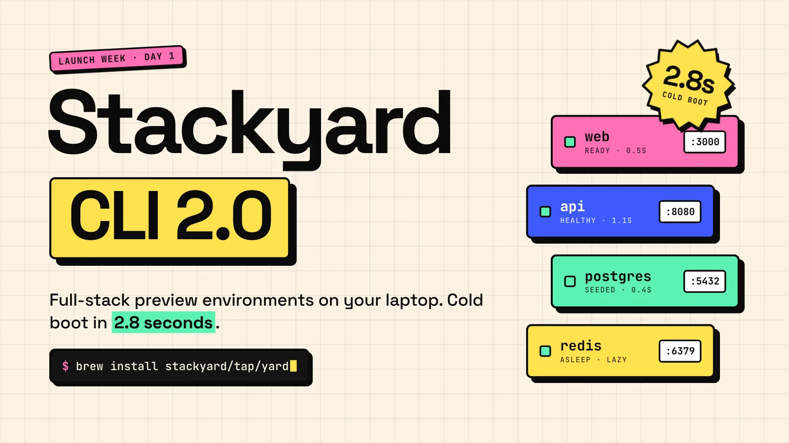 | **Stackyard CLI 2.0 — Launch** | Stackyard CLI 2.0 的发布周演示稿。 | 15 |
